# Лабораторна робота 1: Система контролю версій Git

**Мета роботи:** вивчити основні засоби роботи з репозиторієм Git.

---

## Лабораторне завдання

### 1. Перші кроки у роботі з Git

1. 

2. 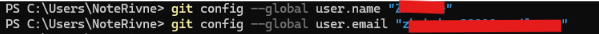

3. 

4–7. 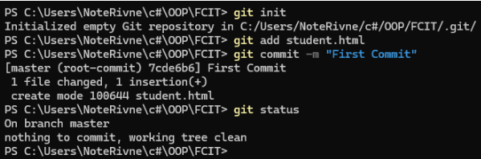

8, 9. 

10–12. 

---

### 2. Робота з гілками

При роботі над великим проєктом його розбивають на модулі та дають доступ декільком розробникам. Кожен з них робить свою частину, проте їм потрібно буде зібрати ці частини докупи. У такому разі стане у нагоді використання гілок.

1. Спочатку треба створити файл, з якого починатиметься робота. Як приклад пропонуємо створити проєкт «Калькулятор»:

4. 

5. 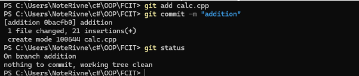

6–9. 

---

## Контрольні запитання для самоконтролю

1. **Як створити Git-репозиторій?**  
   Виконати команду `git init` (для нового) або `git clone <url>` (для копіювання існуючого).

2. **Як долучити файл до репозиторія для контролю версій?**  
   Виконати команду `git add <назва_файлу>` (або `git add .` для додавання всіх файлів одразу).

3. **У скількох станах можуть перебувати файли в репозиторії Git?**  
   Існує 4 основні стани: невідстежувані (*untracked*), незмінені (*unmodified*), змінені (*modified*) та проіндексовані (*staged*).

4. **Яка команда використовується для визначення стану файлу в репозиторії?**  
   Команда `git status`.

5. **Для чого використовується файл `.gitignore`?**  
   Використовується, щоб вказати Git, які файли та папки потрібно ігнорувати (наприклад, скомпільований код, тимчасові файли) і не додавати до репозиторію.

6. **Якою командою переглянути непроіндексовані зміни, зроблені після останнього коміту?**  
   Команда `git diff`.

7. **Якою командою виконується фіксація змін?**  
   Команда `git commit -m "повідомлення до коміту"`.

8. **Як видалити файл з Git-репозиторія?**  
   Команда `git rm <назва_файлу>` (видаляє повністю) або `git rm --cached <назва_файлу>` (видаляє з-під контролю Git, але залишає на комп'ютері).

10. **Як переглянути історію комітів?**  
    Команда `git log`.

11. **Як змінити останній коміт?**  
    Команда `git commit --amend` (дозволяє додати забуті файли або змінити повідомлення).

12. **Яка команда створить нову гілку в Git-репозиторії?**  
    Команда `git branch <назва_гілки>` (або `git checkout -b <назва_гілки>`, щоб створити і відразу перейти в неї).

13. **Як об‘єднати гілки А та Б?**  
    Спочатку потрібно перейти в цільову гілку А (`git checkout A`), а потім виконати злиття з гілкою Б командою `git merge B`.

---

## Висновок

Під час виконання практичних завдань та опрацювання контрольних питань було успішно закріплено основи роботи з локальними репозиторіями Git. Засвоєно ключові етапи відстеження файлів (індексація через `add` та фіксація через `commit`), а також навчено керувати станами файлів та ігнорувати непотрібні дані за допомогою `.gitignore`. Практичне знайомство з механізмом гілок (`branch`, `merge`) показало, що Git є критично важливим інструментом для будь-якого розробника, адже він дозволяє безпечно ізолювати експериментальний код, відстежувати повну історію розробки та ефективно об'єднувати різні частини проєкту без ризику втрати даних.

---
---

# Лабораторна робота 2: Створення віддаленого репозиторія GIT

**Мета роботи:** вивчити основні засоби створення та наповнення віддаленого репозиторія Git у консолі.

---

## Лабораторне завдання

### 1. Створення віддаленого репозиторія

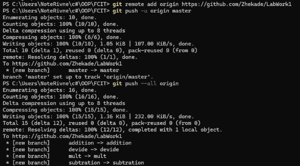

---

### 2. Створення нового функціоналу у новій гілці

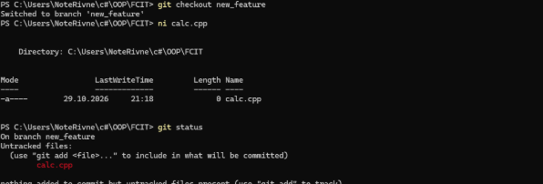

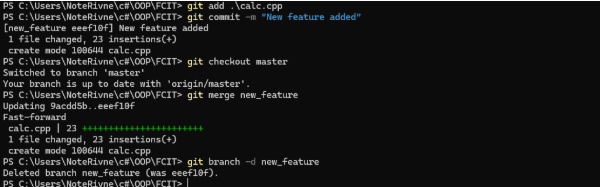

---

### 3. Надсилання змін до сервера

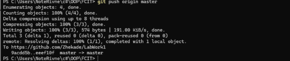

---

## Контрольні запитання для самоконтролю

1. **Для чого використовується команда `add` при роботі з Git?**  
   Додає змінені файли до індексу, готуючи їх до збереження.

2. **Для чого використовується команда `init`?**  
   Створює новий порожній локальний Git-репозиторій у поточній папці.

3. **Для чого використовується команда `status`?**  
   Показує поточний стан файлів (додані, змінені, невідстежувані).

4. **Для чого використовується команда `commit`?**  
   Показує поточний стан файлів (додані, змінені, невідстежувані).

5. **Що необхідно писати в коментарях комітів?**  
   Короткий і чіткий опис того, які саме зміни, виправлення чи новий функціонал містить цей коміт.

6. **Для чого використовується команда `checkout`?**  
   Використовується для переходу між гілками чи комітами, а також для відновлення файлів до їхнього попереднього стану.

7. **Для чого використовується команда `reset`?**  
   Скасовує попередні коміти або прибирає файли з індексу (діє як скасування `git add`).

8. **Для чого використовується команда `log`?**  
   Виводить хронологічну історію всіх збережених комітів.

9. **Як відновити кілька файлів з попередньо створеного коміта?**  
   `git checkout <хеш_коміта> -- <файл1> <файл2>`.

10. **Як перейти до попереднього коміта по імені?**  
    Виконується командою `git checkout <хеш_коміта>`.

11. **Як перейти до попереднього коміта по коментарю?**  
    Прямої команди немає. Спочатку потрібно знайти хеш коміту через пошук `git log --grep="текст_коментаря"`, а потім перейти до нього через `git checkout <хеш>`.

12. **Як створити нову гілку?**  
    Командою `git branch <назва_гілки>`.

13. **Як перейти на нову гілку?**  
    Командою `git checkout <назва_гілки>`.

14. **Як перейти на основну гілку?**  
    Командою `git checkout master` (або `main`).

15. **Як виконати повне злиття гілок?**  
    Потрібно спочатку перейти в основну гілку, а потім виконати `git merge <назва_гілки_з_новим_кодом>`.

16. **Як виконати часткове злиття гілок?**  
    Виконується командою `git cherry-pick <хеш_коміта>` (щоб перенести лише один конкретний коміт з іншої гілки) або `git checkout <назва_гілки> -- <назва_файлу>` (щоб стягнути лише окремий файл).

---

## Висновок

Під час виконання лабораторної роботи було успішно налаштовано взаємодію між локальним та віддаленим репозиторіями на базі GitHub. На практиці закріплено процес ізольованої розробки: створення окремої гілки (`new_feature`) для розширення функціоналу (реалізація піднесення до степеня), фіксація цих змін, їх безпечне злиття з основною гілкою `master` та остаточне відправлення готового коду на віддалений сервер командою `git push`. Застосування такого підходу гарантує збереження цілісності основного коду під час тестування та впровадження нових можливостей.

---
---

# Лабораторна робота 3: Робота з віддаленим репозиторієм GIT

**Мета роботи:** вивчити основні засоби роботи з віддаленим репозиторієм Git у консолі.

---

## Лабораторне завдання

### 1. Клонування віддаленого репозиторія

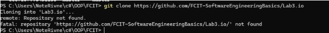

---

### 2. Змінення копії репозиторія

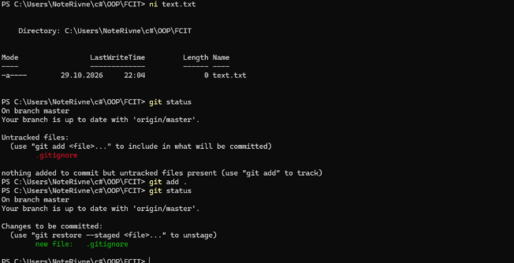

---

### 3. Відкочування «невдалого» коміту

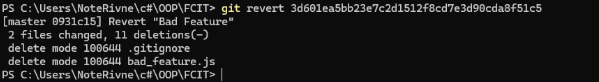

---

### 4. Створення та наповнення своєї версії віддаленого репозиторія

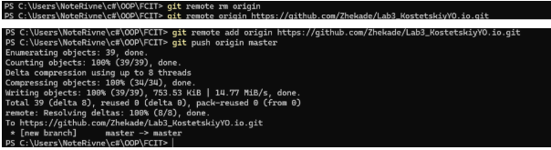

---

## Контрольні запитання для самоконтролю

1. **Для чого використовується команда `clone` при роботі з Git?**  
   Використовується для створення повноцінної локальної копії існуючого віддаленого репозиторія.

2. **Для чого використовується команда `remote`?**  
   Використовується для управління підключеннями до віддалених серверів.

3. **До чого відноситься ім’я `origin`?**  
   Це стандартна (за замовчуванням) назва, яку Git автоматично присвоює головному віддаленому репозиторію, з яким зв'язаний ваш локальний проєкт.

4. **Для чого використовується команда `pull`?**  
   Завантажує нові зміни з віддаленого репозиторія та одразу автоматично об'єднує (`merge`) їх із вашим поточним локальним кодом.

5. **Для чого використовується команда `push`?**  
   Відправляє ваші нові локальні коміти на віддалений сервер, щоб оновити там інформацію та зробити її доступною для інших.

6. **Для чого використовується команда `revert`?**  
   Безпечно скасовує зміни обраного коміту. Вона не видаляє його з історії, а створює *новий* коміт, який робить дії, повністю протилежні до скасованого.

7. **Для чого використовується команда `fetch`?**  
   Завантажує інформацію про нові зміни з віддаленого сервера, але, на відміну від `pull`, не об'єднує їх з вашим кодом автоматично (дозволяє просто безпечно переглянути, що змінилося).

8. **Для чого використовується файл `.gitignore`?**  
   Вказує системі Git, які файли або папки потрібно ігнорувати (не відстежувати і ніколи не додавати в коміти), наприклад, скомпільований код, тимчасові файли або конфіги з паролями.

---

## Висновок

Під час виконання лабораторної роботи було успішно закріплено навички взаємодії з віддаленими репозиторіями. На практиці відпрацьовано процес клонування готового проєкту (`git clone`), його локальної модифікації (створення вебсторінки) та налаштування правил ігнорування файлів через `.gitignore`. Важливим етапом стало засвоєння механізму безпечного скасування помилкових змін за допомогою `git revert`, що дозволило відкотити «невдалий» функціонал без руйнування загальної історії розробки. Зрештою, успішно виконано процес переприв'язки проєкту: відключення від чужого шаблону (`git remote rm`), підключення до власного віддаленого репозиторію на GitHub та фінальне вивантаження коду (`git push`).
